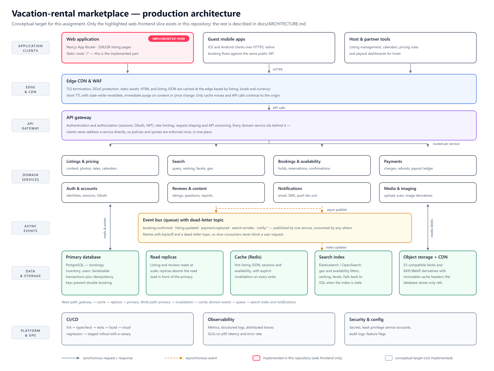

# Architecture

## Diagram

- **PNG export:** `docs/architecture-diagram.png` (2x resolution, 3360×2520)
- **PDF export:** `docs/architecture-diagram.pdf` (vector, single page)
- **Source:** `docs/architecture-diagram.svg` — edit the SVG and re-render to update the exports

The diagram shows a production-scale vacation-rental marketplace. The one shaded element — the web application — is what this repository actually implements; everything else is the conceptual target this document explains.

## Conceptual vs implemented

**Implemented in this repository: the frontend only.** One statically rendered route (`/`) with client-side overlays, local assets and static content. There is no API (`src/app/api` does not exist), no database, no auth, no payments and no deployment/infrastructure configuration beyond `next.config.ts`.

| Layer | Status here |
|---|---|
| Rendering | Implemented — Next.js 16 App Router; `npm run build` prerenders `/` and `/_not-found` as static |
| Client state | Implemented — `ListingUIProvider` (tour, lightbox, amenities, toast, saved, share, reserve) |
| Content | Implemented — static typed data in `src/components/listing/data.ts` |
| Assets | Implemented — images served from `public/images/listing/` with plain ``; no image-optimisation pipeline |
| Backend, data, search, deployment | **Not implemented** — conceptual target below |

## Frontend delivery

- **CDN + edge caching:** cache rendered HTML and listing JSON at the edge keyed by listing id, locale and currency; short TTL with stale-while-revalidate, immediate purge on content or price changes. A WAF and TLS termination sit in front.
- **SSR/ISR for listings:** render listing pages on demand and revalidate them (ISR) so cold traffic stays cheap and edits propagate without a full rebuild; personalisation (currency, availability) is applied at the edge or on the client.
- **This repo instead** ships a fully static route with fixed-size images copied from the reference captures — which is why `next/image` is not used and why the CDN/ISR behaviour above is conceptual.

## Backend services

- **API gateway** in front of every service: authentication/authorization, rate limiting, request shaping and versioning. Clients never address a service directly.
- **Domain services:** *listings* (content, pricing, calendars), *bookings* (availability, reservations, confirmations), *search* (query, ranking), *auth* (accounts, sessions, OAuth), *payments* (charges, refunds), *reviews*, *notifications* (email/SMS/push), *media* (upload, scanning, derivatives).
- **Async event bus:** booking confirmations, payment webhooks, search-index updates and notification fan-out run through a queue with retries and a dead-letter topic, so slow consumers never block a user request.

## Database

- **Relational database for bookings** with strong consistency: serializable transactions (or row-level locks on inventory rows) plus idempotency keys on reservation requests, so two guests can never hold the same date range — double-booking is prevented at the storage layer, not in application code.
- **Read replicas** absorb listing and reviews reads (the read/write ratio is heavily skewed); the write path stays pinned to the primary.
- **Cache and read replicas** for listing reads: replicas absorb the read load, a cache sits in front with explicit invalidation on write.

## Image storage

- **Object storage + CDN** for listing photos and media: S3-compatible blobs with content-hashed names, on-the-fly resize and format negotiation (AVIF/WebP), `srcset` for the hero grid and rails, lazy loading below the fold and immutable cache headers for derivative variants.
- The database holds only references and metadata; the *media* service handles upload, scanning and derivative generation.

## Search

- A **dedicated search index** (Elasticsearch/OpenSearch or a managed equivalent), updated from the event queue on listing and booking events: geo filtering (bounding box or geohash, distance sorting) combined with availability filters joined from booking data, plus ranking and facets. Falls back to a database query when the index is stale.

## Caching

Three tiers, each with a different job:

| Tier | Stores | Invalidation |
|---|---|---|
| Edge/CDN | rendered HTML, listing JSON, image derivatives | short TTL + stale-while-revalidate; purge on content or price change |
| Application cache (Redis) | hot listing JSON, sessions, availability | explicit invalidation on every write, driven by the write path |
| Database | source of truth | replicas catch up from the primary's WAL |

## Deployment and operations

- **CI/CD:** lint → typecheck → unit tests → build → visual regression (`tools/qa.js` + `tools/diff.py`) → staged rollout with a canary.
- **Runtime:** containerised services (or serverless/edge functions for the frontend), with autoscaling on request rate.
- **Observability:** metrics, structured logs and distributed traces, with SLOs on p95 latency and error rate; alerting on checkout/booking failure rate.
- **Multi-region:** active-active read serving with regional caches, while booking writes stay pinned to a single writer region so the consistency guarantee above holds.

## Relation to this codebase

`src/components/listing/` maps onto the *listings* service's read model: `data.ts` stands in for the JSON a listing API would return, and the overlays (tour, lightbox, amenities) are pure client state that would survive a move to real API data unchanged. Nothing else in this document exists in code today.
